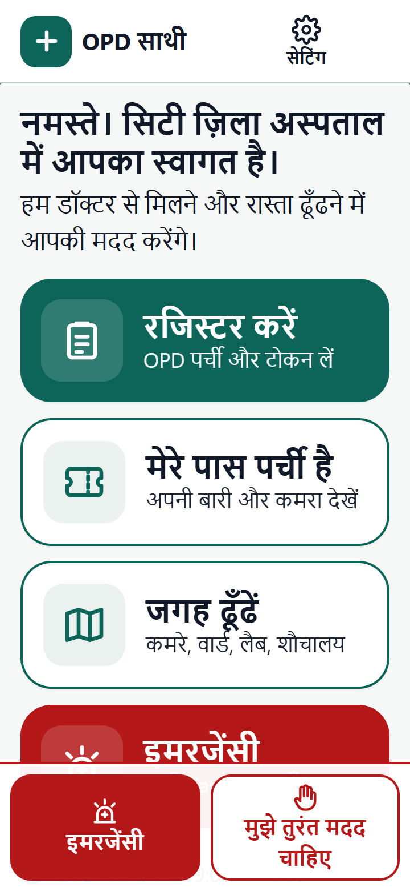
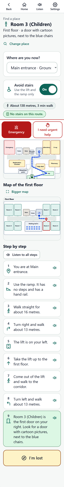
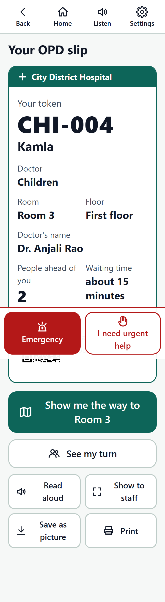
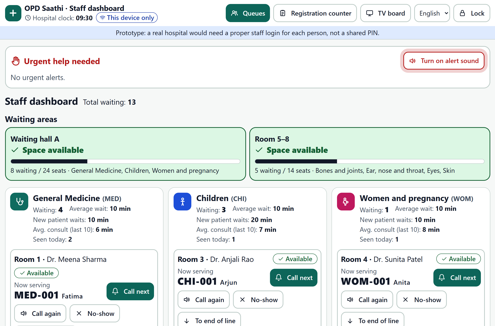

# OPD Saathi — register, wait and find your way in a government hospital

**The problem, in two lines:** Patients at government hospitals wait hours to register and see a doctor, then can't find the room or ward written on their slip.
Registration is hardest for exactly the people who need the hospital most: elderly patients, people with disabilities, people who don't read English, and people who rarely use smartphones.

**OPD Saathi** ("OPD companion") is a working web-app prototype. A patient registers in their own language, gets an OPD slip with a token, sees their place in the line, is told when their turn is close, and is guided step by step to the right room — while staff run the queues from a live dashboard and a TV board calls tokens aloud.

> Everything is simulated: *City District Hospital*, its doctors and its patients are made up. The app never asks for Aadhaar, ABHA or any ID.

| Patient home (Hindi) | Route with landmarks | OPD slip | Staff dashboard |
|---|---|---|---|
|  |  |  |  |

---

## Who it is for

- **Kamla, 62** — our main user. Visiting alone, reads a little Hindi, has a basic Android phone, walks slowly and avoids stairs.
- **Helpers** — a son, a neighbour or a volunteer filling it in for someone ("Someone is helping me").
- **People with no phone** — registered in a few taps at the counter, with a printed slip.
- **Hospital staff** — registration counter, doctors' rooms, nurses and the help desk.

## What it does (one line per screen)

| # | Screen | What it does |
|---|---|---|
| 1 | **Home** `/` | Four big buttons with an icon and a word: Register · I have my slip · Find a place · Emergency. First visit asks for a language, each shown in its own script. |
| 2 | **Register** `/register` | First shows the emergency signs, then one question per screen (name, age, gender, mobile — optional, doctor) with "Step 2 of 5", voice input, picture cards, assisted mode, and Back that keeps every answer. |
| 3 | **OPD slip** `/slip/MED-042` | Token, name, department, room, floor, doctor, people ahead, estimated wait and a QR code. Save as a picture, print, read aloud, or show in large type to staff. |
| 4 | **My turn** `/turn/MED-042` | "6 people ahead of you, about 25 minutes", the token being served now, each doctor's status, and what to do next. At 3 ahead: vibration, chime, banner, notification and a simulated SMS. When called: big type and directions. |
| 5 | **I have my slip** `/have-slip` | Type the token (or say it), or scan the QR code with the camera where the browser supports it. |
| 6 | **Find a place** `/find` | Search or pick any place. SVG floor plan with the route drawn on it, step-by-step directions with landmarks, Avoid stairs, Listen, and I'm lost. |
| 7 | **Emergency** `/emergency` | Go to Casualty now or tell any staff member; call 112 / 108; the route on the map; the signs list. No token needed. |
| 8 | **Settings** `/settings` | Language (English / हिंदी / தமிழ்), 3 text sizes, high contrast, read aloud, avoid stairs, assisted mode, Install app. |
| 9 | **Staff dashboard** `/staff` | Urgent alerts pinned on top with an alarm; crowding per waiting area; each queue with Call next, Call again, No-show, To end of line, Move to another department; doctor status; demo controls. |
| 10 | **Registration counter** `/staff/counter` | Register a patient with no phone in a few taps and print their slip in their language. |
| 11 | **Waiting-room board** `/board` | TV view: token in each room, next three, delays; rotates languages; announces each call aloud. |
| — | **I'm lost** `/lost` | Route to the nearest help desk + a big card to show staff (patient's language and English). |

## Emergencies come first — and the app never decides who is urgent

- A red **Emergency** button and an **I need urgent help** button are fixed to the bottom of **every** patient screen, including before registration. Even the loading screen (shown before the app finishes downloading) has the emergency message, 112 and 108.
- The first registration screen lists the signs that need care right away and says: *"Any of these? Go to Emergency now. You don't need a token."*
- **I need urgent help** sends an alert to the **top of the staff dashboard** with a repeating alarm until a staff member taps *Mark as seen*. The patient's screen turns green when it has been seen, and they can add where they are. It reached the dashboard in **77 ms** (same browser) and **236 ms** (through the server) in our tests.
- **Why the app never decides:** triage needs a trained person who can see and examine the patient. A symptom checker can be wrong in both directions — and a wrong "you can wait" could kill. So the app has *no* questions about severity, *no* scores and *no* "you can wait" messages anywhere. It only does two things: tells people where Emergency is, and gets a qualified person to them faster. The dashboard alert says: *"Send a doctor or nurse to assess now. Do not make them wait for a token."* Registration and tokens are never in the way of emergency care.

## Design decisions and why

| Decision | Why |
|---|---|
| **Assisted mode** ("Someone is helping me") | Many patients come with a helper, or need one. One switch makes text the biggest size, reads every question aloud, sets "avoid stairs", and shows a note telling the helper what to do. |
| **Picture cards in plain words** | Patients don't know what "Orthopaedics" means. Cards say "Bones and joints — knee, back and joint pain, fractures", with a picture. "Not sure? Ask at the help desk" leads to directions. |
| **One question per screen, progress bar** | Less to read at once; "Step 2 of 5" tells people how much is left. Back (and the phone's own Back button) keeps every answer. |
| **Avoid stairs** | Elderly, pregnant and disabled patients often can't climb. Routes then use only the lift and the ramp — tested on all 961 pairs of places. |
| **Three languages, all text** | English, हिंदी and தமிழ். Every word switches: buttons, directions, landmarks, doctor names, the SMS and the board's announcements. Words people see on hospital signs (OPD, Casualty, X-ray) stay as they are, in brackets. |
| **Read aloud everywhere** | For people who barely read. Every screen has a Listen button; each direction step has its own. If the phone has no voice for a language, Listen is hidden instead of reading in the wrong language. |
| **Landmarks, not compass directions** | "Room 3 is the first door on your right. Look for a door with cartoon pictures, next to the blue chairs." Turns and door counts are worked out from the floor plan. |
| **Big, clear, high contrast** | Body text ≥ 18 px, buttons ≥ 56 px, WCAG AA colours, visible focus, every icon labelled. Lighthouse accessibility score **100**. Never colour alone — every status also has a word and an icon. |
| **Works on weak connections** | Installable PWA; the app, maps, directions and the patient's slip open with no connection. Registrations made offline are kept and sent later. |

## How the waiting time is worked out

```
estimated wait = people ahead × average of the last 10 consultations ÷ doctors seeing patients
                 + the doctor's delay (minutes late, or time left on a break)
```

It starts from a sample average per department (in `src/data/departments.js`), is **rounded to 5 minutes**, shown as **"about 25 minutes"**, and recalculated every time the queue moves. General Medicine has two doctors sharing one queue, so its wait is shared between them. The code is `estimateWait()` in `shared/engine.js`.

## How it improves on a hospital visit today

| Today | With OPD Saathi |
|---|---|
| Stand in a registration line before anything else | Register on your phone in your language, or in a few taps at the counter |
| Emergency patients may wait in the same lines | Emergency info on every screen; urgent alerts ring on the staff dashboard |
| No idea how long the wait is | "6 people ahead of you, about 25 minutes", live |
| Stay near the door for fear of missing your name | Sit down; your phone vibrates and shows a message when 3 are ahead, and the TV board calls your token aloud |
| "Ward 4? Where is that?" | Step-by-step directions with landmarks, avoiding stairs if needed, read aloud |
| Staff can't see where crowds are building | Crowding colour per waiting area; average waits per department; move patients between queues |

## How to run it

You need **Node.js 18+** (tested on Node 24).

```bash
npm install
npm run dev          # starts the server (port 3001) and the app (port 5173) together
```

Open these in three tabs or on three devices on the same Wi-Fi (use the laptop's IP address, e.g. `http://192.168.1.20:5173`, on phones):

- Patient: http://localhost:5173
- Staff dashboard: http://localhost:5173/staff (prototype PIN **4321**)
- TV board: http://localhost:5173/board

**Production (one server, one link):**

```bash
npm run build
npm start            # serves the app and the live queue on http://localhost:3001
```

**No server?** Run only `npm run dev:app`. The app notices there is no server and switches to *this browser only* mode: tabs in the same browser still stay in sync (localStorage + BroadcastChannel). Force a mode with `?mode=local` or `?mode=server`.

**Demo controls** (bottom of the staff dashboard): add 20 sample patients, clock speed 1x / 10x / 30x, "Run queues by themselves", and Reset everything.

**Tests**

```bash
npm test                 # queue engine, all 961 routes, translation completeness
npm run test:screens     # every screen at 360px in 3 languages, biggest text, high contrast: no errors, nothing too wide
npm run test:e2e         # the full story across phone, dashboard and board (needs `npm run dev` running)
npm run test:e2e:server  # the same with three separate devices through the server
npm run test:offline     # server down, offline registration, PWA cache, permissions
```

Putting it online for the judges: see **[docs/DEPLOY.md](docs/DEPLOY.md)**. Demo script: **[docs/DEMO_SCRIPT.md](docs/DEMO_SCRIPT.md)**.

## How it is built (and why these tools)

| Part | Choice | Why |
|---|---|---|
| App | React 18 + Vite + Tailwind CSS + React Router, plain JavaScript | Fast to build, tiny production bundle (≈108 KB gzipped for the first screen), mobile-first utilities |
| Live sync | Node + Express + **Socket.io** | No accounts or API keys (unlike Firebase/Supabase), works on a laptop hotspot with no internet, server-enforced staff permissions, auto-reconnect with long-polling fallback for networks that block WebSockets |
| Fallback sync | localStorage + BroadcastChannel | Zero-dependency; keeps the demo alive without a server |
| Shared rules | `shared/engine.js` | The **same** queue code runs on the server and in the browser, so the two can never disagree |
| Offline | vite-plugin-pwa (Workbox) | Precaches the whole app; installable |
| Maps | Inline SVG + Dijkstra over a graph in `src/data/hospital.js` | A few KB, sharp at any size, no map library |
| Voice | Web Speech API | Built in, free, supports hi-IN and ta-IN on Android |
| QR | `qrcode-generator` (make), browser BarcodeDetector (scan) | Smallest options; scanning needs no library |

Folder map: `src/data` (hospital, departments, sample patients) · `src/i18n` (en, hi, ta) · `shared/engine.js` (queue rules) · `src/store` (sync) · `src/screens` (patient) · `src/staff` (dashboard, counter, board) · `server/` (Socket.io server) · `scripts/` (tests) · `docs/` (plan, log, deploy, demo).

**Privacy and security in the prototype:** patients' phones and the board receive only tokens (no names, ages or numbers); only connections with the staff PIN can call, move or remove patients; the server limits how often one connection can register or raise alerts. **A real hospital needs proper staff logins** (one per person, with roles and audit logs), not a shared PIN.

## What is simulated

- The hospital, floors, doctors, patients and the 20 sample patients.
- SMS messages (shown on screen as "SMS (simulated)"; no message is sent).
- The hospital clock when sped up (10x / 30x) and "Run queues by themselves".
- Staff login (a shared prototype PIN).
- No connection to any real hospital system (HMIS, ABHA, eHospital).

## What we'd build next

1. Real SMS / WhatsApp alerts (in the patient's language) through a government SMS gateway.
2. Proper staff accounts with roles (counter, doctor, nurse, admin) and an audit log.
3. Connect to the hospital's HMIS / eHospital and ABHA (with consent) instead of our own queue.
4. Next steps after the doctor: lab and pharmacy queues with their own tokens.
5. Indoor positioning from QR stickers on walls ("scan the sticker to see where you are").
6. More languages (Bengali, Marathi, Telugu …) and recorded human voices for phones without a voice.
7. Kiosk mode for a shared tablet at the entrance, with a printer.
8. Analytics for administrators: peak hours, average waits, no-show rates.

## Documents

- [docs/PLAN.md](docs/PLAN.md) — the build plan and technology choices
- [docs/DEV_LOG.md](docs/DEV_LOG.md) — everything we did, in order (for the project report)
- [docs/CHECKLIST.md](docs/CHECKLIST.md) — every requirement and its status
- [docs/DEPLOY.md](docs/DEPLOY.md) — putting it online
- [docs/DEMO_SCRIPT.md](docs/DEMO_SCRIPT.md) — 3-minute demo and what could go wrong
